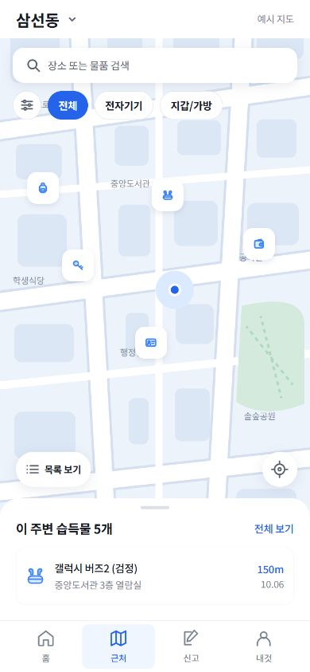
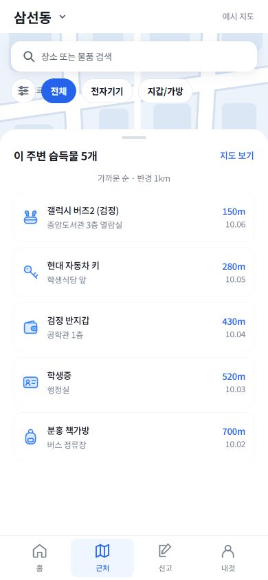

# 10 근처 탭

## 현재 구현 (2026-11-23)

- 운영 웹과 앱은 실제 지도·카카오 장소 검색·주변 습득물 API에 연결되어 있습니다.
- 기기 위치 권한을 허용하면 기기가 제공한 좌표를 지도와 주변 검색에 사용합니다. 권한 거부·위치 실패 시 직접 장소를 선택할 수 있습니다.
- 회원 물품의 습득 좌표와 기관 물품의 확인된 보관처 좌표를 기준으로 반경·물품·기간 조건을 적용합니다.
- 목록, 확인된 주변 건수, 더보기와 물품 상세를 제공하며 이전 검색 조건의 확인 결과는 갱신 중 재사용합니다.
- 좌표 미확인 기관이나 원본 장애에 따라 자료가 제한될 수 있습니다. 상세 기준은 [백엔드 안내](../missu-backend/README.md)를 따릅니다.

## 초기 화면 개발 기록

아래 캠퍼스 일러스트·예시 물품·미연동 설명과 검사 결과는 초기 화면 구현 당시 기록입니다.

- [Figma 10.01–10.12](https://www.figma.com/design/Fg3A56JQuGDVvWROpvUdEx/MissU?node-id=201-1108)의 지도, 선택, 목록, 필터, 장소·물품 검색, 지역 재검색, 빈 결과와 위치 안내 상태를 `/nearby`에서 확인할 수 있다.
- 01 홈 카드와 하단 근처 탭에서 진입한다. 마커를 선택하거나 목록의 물품을 누르면 03 물품 상세로 이어진다. 상세에서 돌아오면 근처 지도·검색 조건과 목록 상태가 유지된다.
- 필터는 물품 종류, 기간, 반경을 조합한다. 지갑/가방은 예시 목록의 반지갑과 책가방을 모두 포함한다. 등록 기간은 모의 데이터의 습득 날짜를 사용한다.
- Android와 iOS에서는 실제 지도를 사용한다. 처음 열면 한성대학교 캠퍼스 중심으로 반경 1km를 조회한다. **내 주변**을 누르고 위치 권한을 허용하면 기기 위치로 이동한다. 권한이 없으면 장소를 직접 검색할 수 있다.
- 웹에서는 Figma의 캠퍼스 일러스트와 삼선동 예시 위치를 사용한다. 물품과 장소 검색 데이터는 예시이며, 모바일의 물품 좌표도 예시 배치다. 주변 조회·장소 검색 API는 계약이 정해지면 연결한다.

## 팀원 실행 방법

지도 변경이 포함된 브랜치를 받은 뒤, Android Studio에서 에뮬레이터를 실행하고 `MissU_Frontend` 폴더에서 다음 명령을 실행한다.

```sh
npm ci
npm run android -- --go --port 8081
```

Expo Go에서 앱을 열고 **홈 → 근처**로 이동하면 실제 지도를 볼 수 있다. **내 주변**을 확인할 때는 에뮬레이터에서 **Extended controls → Location → Set location**으로 테스트 위치를 설정한다. 지도는 Expo Go에서 별도 키 없이 확인할 수 있다. 독립 Android 빌드에서 Google Maps를 사용하려면 앱의 Google Maps SDK 설정이 필요하다. [Expo 지도 설정](https://docs.expo.dev/versions/latest/sdk/map-view/)

## 확인

- `npm run check`와 기존 검색 테스트 6개 통과.
- Expo 웹 390 × 844에서 홈 진입, 마커 → 상세 → 복귀, 거리순 목록, 종류·기간·반경 필터, 빈 결과 복구, 장소·물품 검색, 지도 이동·지역 재검색, 위치 안내의 직접 검색을 확인했다.
- Expo 웹 320 × 568에서 목록 스크롤, 상세 이동, 하단 탭과 필터 시트 표시를 확인했다.
- Android Pixel 6 에뮬레이터의 Expo Go에서 03 검색 → 근처 탭, 지도 마커 선택 → 03 상세 → 선택 화면 복귀를 확인했다.
- 실제 지도 변경 후 Android Expo Go에서 홈 → 근처, 한성대학교 기본 중심, 내 위치 마커, 예시 습득물 마커 → 03 상세를 확인했다.



