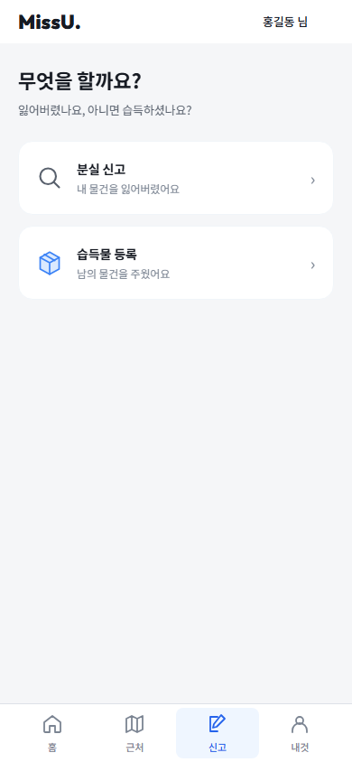
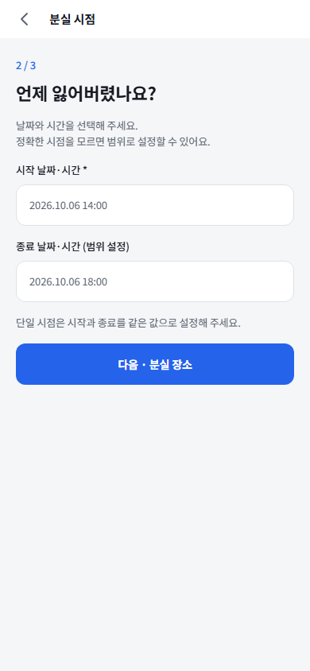
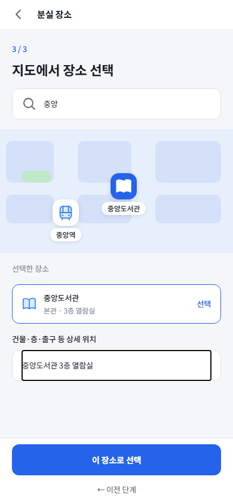
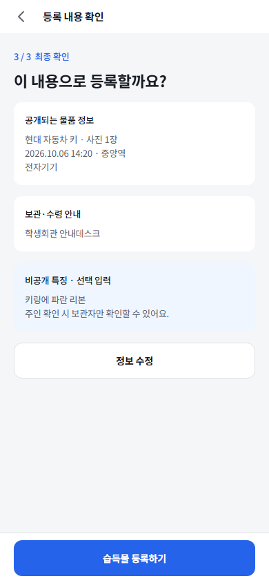
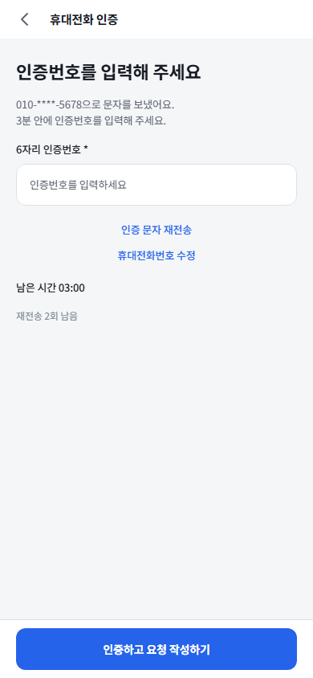
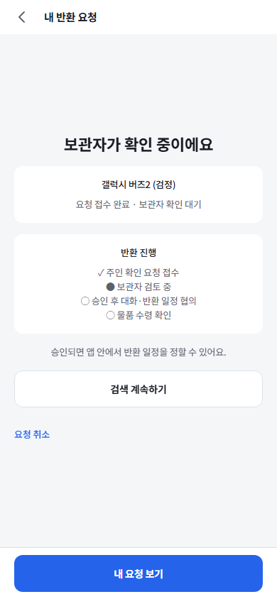
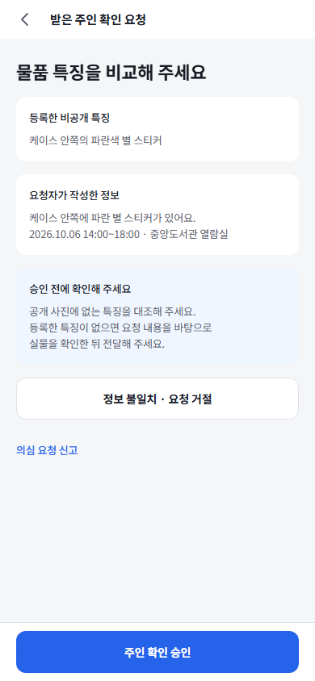
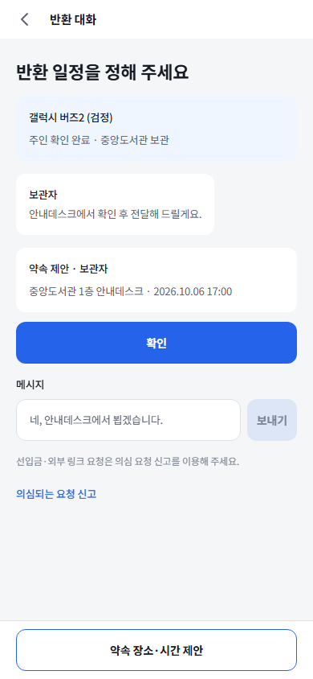
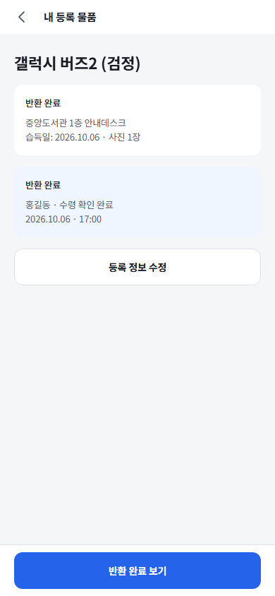
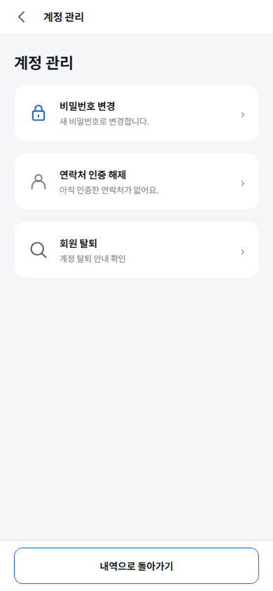

# 04·05·09 신고·등록과 07·08·08-B 반환 흐름

Figma `MissU / 화면 흐름`의 04(분실 신고), 05(습득물 등록), 09(장소 선택), 07(연락처 인증), 08(요청자), 08-A(의심 요청 신고), 08-B(보관자)와 01·02의 추가 화면(01.07 상태, 01.08, 01.09, 01.05 상태, 02-A.05, 02-A.06)을 React Native + Expo Router로 구현했다. 2026-11-09 04:18(UTC) 기준 Figma 파일을 REST API로 읽어 문구·연결을 맞췄다.

## 범위와 경로

| Figma               | 화면                                                 | 경로                                                         |
| ------------------- | ---------------------------------------------------- | ------------------------------------------------------------ |
| 04.01               | 신고 탭(회원) 유형 선택                              | `/report`                                                    |
| 04.02~04.05         | 분실 물품 입력 → 시점(범위) → 장소 → 완료            | `/report/lost`, `/lost/when`, `/lost/where`, `/lost/done`    |
| 05.01~05.05, 05.01-A/-P | 물품 정보(사진 시트, 권한 안내) → 보관 정보 → 확인 → 완료 | `/report/found`, `/found/storage`, `/found/confirm`, `/found/done` |
| 05.02-A             | 등록 정보 수정                                       | `/my-items/[id]/edit`                                        |
| 09.01~09.04, 09.02-E | 지도 장소 검색·결과·선택·결과 없음                  | `/report/found/place`, `/report/lost/where`                  |
| 01.07(-L/-E/-A/-D/-C) | 내 등록 물품과 받은 요청 상태                      | `/my-items/[id]`                                             |
| 01.08, 01.08-C      | 내 분실 신고 상세·삭제 확인                          | `/my-reports/[id]`                                           |
| 01.09               | 내역 목록(탭 3개)                                    | `/history/list?tab=lost\|requests\|found`                    |
| 01.05(-L/-E/-C), 01.04-S | 내역 로딩·빈 상태·로그아웃 확인·세션 만료 안내  | `/history`                                                   |
| 07.00~07.04, 07.01-E | 연락처 인증 동의 → 번호 → 인증번호(오류)           | `/verify-phone/consent`, `/verify-phone`, `/verify-phone/code` |
| 08.01(-E)           | 주인 확인 작성                                       | `/requests/new?itemId=`                                      |
| 08.02, 08.06, 08.03(-E), 08.03-A, 08.04(-C), 08.05, 08-A.00 | 요청 상태별 화면 | `/requests/[id]`, `/requests/[id]/propose`                   |
| 08-A.01(-C), 08-A.02 | 의심 요청 신고·접수 완료                            | `/requests/[id]/report?role=`, `/requests/[id]/reported`     |
| 08-B.01(-C)~08-B.04, 08-B.02-A/-B | 보관자 검토·진행·대화·제안·전달·완료   | `/my-items/[id]/requests/[requestId]`, `/chat`, `/propose`   |
| 02-A.06(-C/-U), 02-A.05 | 계정 관리, 새 비밀번호                          | `/account`, `/account/password`                              |

진입점: 하단 신고 탭 → 04.01(비회원은 01.06), 03.M 상세의 "내 물건 확인 요청" → 연락처 인증 여부에 따라 07.00 또는 08.01, 01.05 카드 → 1건이면 상세, 2건 이상이면 01.09 목록. 상세 화면의 `종류`와 사진 자리(가로 스크롤)도 Figma 03.G/03.M에 맞춰 추가했다.

## 모의 데이터와 상태

- `src/lib/activity/`가 회원의 활동(분실 신고, 등록 습득물, 주인 확인 요청)을 메모리에 들고 있다. `transitions.ts`는 순수 상태 전이(승인·거절·약속 제안·확인·전달·수령·취소)이고 `ActivityProvider`가 모의 지연(300ms) 뒤 적용한다. 서버 계약이 없으므로 HTTP 호출은 없다. 릴리스 빌드는 모든 동작을 "서버 연결 전" 오류로 돌려준다.
- 요청 상태는 `pending → approved → scheduled → handed → completed`와 `rejected`다. 요청자(08)와 보관자(08-B)가 같은 요청을 보며, 한쪽이 바꾼 상태가 다른 쪽 화면에 바로 반영된다. 예시 회원(홍길동)은 등록 물품 `갤럭시 버즈2`의 보관자이자 그 물품에 요청을 보낸 요청자라서, 한 계정으로 양쪽 흐름을 끝까지 눌러 볼 수 있다.
- 예시 데이터는 로그인·회원 미리보기 때 들어오고 회원가입 직후에는 비어 있어 01.05-E가 나온다. 앱을 새로 고치면 초기화된다.
- 연락처 인증(07)은 어떤 6자리든 통과하고 `000000`만 오류(07.04)로 처리한다. 남은 시간 3분과 재전송 2회를 센다. 인증 번호는 세션의 프로필에만 저장된다.
- 사진은 장수만 센다(`mockPhotoPicker.ts`). 실제 카메라·앨범은 `expo-image-picker` 같은 네이티브 모듈이 필요해 아직 넣지 않았다. 피커가 권한 거부를 돌려주면 05.01-P 안내가 나오도록 연결만 되어 있다.
- 장소 검색(09)은 Figma의 예시 2곳(중앙도서관, 중앙역)만 있고 지도는 그림이다. 지도·장소 제공처는 10 근처 탭 담당과 함께 정해야 한다.
- 날짜·시간은 `2026.10.06 14:00` 형식의 글자 입력을 서울 시간으로 해석한다(`src/lib/dateTime.ts`). 날짜 선택기는 없다.

## 앱에서 정한 규칙 (Figma와 다른 점)

Figma 연결이 고정 화면을 가리키거나 비어 있던 곳은 다음 규칙으로 구현했다. 번호는 `docs/figma-review.md` 7절의 항목이다.

- 뒤로가기(←)는 항상 직전 화면으로 간다. 직접 열었을 때만 지정한 화면으로 간다(N7).
- 보관자가 거절을 확인하면 01.07로 돌아간다. Figma는 요청자 화면 08-A.00으로 갔다(N1).
- 신고(08-A.01)의 사진 첨부는 같은 사진 시트를 열고 신고 화면으로 돌아온다(N2).
- 신고 수정과 등록 정보 수정은 새 화면 없이 같은 입력 단계를 값이 채워진 채로 다시 쓴다. 저장하면 상세로 돌아오고 완료 화면은 나오지 않는다(N6).
- 07.00은 필수 동의를 체크해야 넘어간다. 회원가입 동의와 같은 규칙이다(N9).
- 02-A.05에서 비밀번호를 바꾸면 Figma대로 로그인 화면으로 가며, 이때 모의 세션은 끝난다(N8).
- 04.03의 종료 시점을 비우면 시작과 같은 단일 시점으로 저장한다. Figma 안내 문구는 그대로 두었다.
- 물품 종류 타일은 입력 뒤에도 접지 않고 계속 보여 바꿀 수 있게 했다. Figma 05.02는 선택한 종류를 글자로만 보여 준다.
- 01.09 탭은 선택된 탭을 채워 표시한다. Figma는 세 탭이 같은 윤곽선이다. 01.09의 하단 탭은 Figma의 변형(둥근 연필 버튼) 대신 기존 하단 탭을 쓴다.
- 02-A.06 행 아이콘은 Figma의 자리 표시(돋보기) 대신 자물쇠·사람 아이콘을 썼다. 회원 탈퇴 행만 돋보기다.
- 08.04에서 약속이 아직 없으면 장소·시간에 "미정"을 보여 준다. 보관자는 약속 확정 전에도 전달 완료를 누를 수 있다.
- Figma에 없는 오류·안내 문구는 임시다: 날짜 형식 오류, 종료 시점 순서, 보관 장소 누락, 상세 위치 누락, 약속 제안 형식, 신고 사유 미선택, 재전송 완료, 재전송 소진, 상대 확인 대기, 받은 요청 0건 이후의 "거절한 요청" 문구.

## 미연동과 남은 결정

- 실제 API 전부(신고·등록·요청·대화·신고·인증·비밀번호 변경·탈퇴). 세션 만료(01.04-S)는 다이얼로그만 있고 아직 아무것도 그것을 켜지 않는다.
- 사진 선택·업로드, 상세의 사진 보기, 위치 권한 상태 표시(01.02-P)는 네이티브 모듈과 10 근처 탭 작업에 달려 있다.
- 등록한 습득물은 검색·홈 목록에 아직 나오지 않는다(`src/lib/items.ts`의 예시 목록과 분리됨, figma-review D12).
- 물품 종류 6가지와 10 근처 필터(전자기기·지갑/가방·기타)의 대응(D7), 지도·장소 제공처(D10), 알림·상태 갱신 방식(D11)은 팀 결정이 필요하다.
- 02의 서버 쪽 오류 변형(이메일·닉네임 중복, 코드 오류·만료, 미가입 이메일)은 모의 API가 만들 수 없어 문구만 Figma와 맞춰 두었다.

## 확인

- `npm run typecheck`, `npm run lint`, `npm test`(단위 테스트 19개: 날짜 처리, 상태 전이, 장소 검색, 전화번호) 통과. `npm run format:check`는 이 PC의 CRLF 설정 때문에 전체 파일이 실패하며, `npx prettier --check --end-of-line auto`로는 통과한다.
- `npx expo export --platform web`, `--platform android` 번들 생성 성공.
- Expo 웹(390 × 844, 회원 미리보기)에서 Playwright로 아래 흐름을 끝까지 눌러 확인했다. 브라우저 오류 없음.
  - 신고 탭 → 분실 신고 3단계(물품명 누락 오류, 장소 검색 결과 없음·결과·선택) → 완료 → 신고 상세·삭제 확인 → 내역·목록 탭
  - 습득물 등록 3단계(장소 선택, 사진 시트, 비활성 버튼, 보관 장소 누락) → 완료 → 내 등록 물품(요청 없음) → 등록 정보 수정 저장
  - 상세 → 연락처 동의(미체크 안내) → 번호 형식 오류 → 인증번호 오류(000000) → 주인 확인 작성(필수 누락) → 확인 대기·취소 확인 → 요청 2건 목록
  - 보관자 검토(거절 확인 취소) → 승인 → 빈 대화 → 메시지·약속 제안 → 요청자 대화에서 의심 신고 접수 → 제안 확인 → 수령 확인 화면 → 보관자 전달 확인 → 수령 완료 → 반환 완료(양쪽) → 01.07 -A/-D/-C
  - 계정 관리 → 새 비밀번호(길이 오류) → 탈퇴 확인 취소 → 프로필 닉네임 수정 → 로그아웃 확인 → 비회원 홈
- Android·iOS 실기기와 Expo Go, 키보드·하드웨어 뒤로가기는 확인하지 않았다.

### 캡처 (Expo 웹)

| 04.01 유형 선택 | 04.03 분실 시점 | 09.03 장소 선택 | 05.04 등록 확인 |
| --- | --- | --- | --- |
|  |  |  |  |

| 07.02 인증번호 | 08.02 확인 대기 | 08-B.01 요청 검토 | 08.03 반환 대화 |
| --- | --- | --- | --- |
|  |  |  |  |

| 01.07-C 반환 완료 | 02-A.06 계정 관리 |
| --- | --- |
|  |  |
