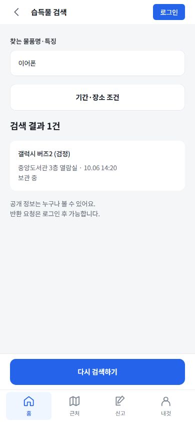

# 03 검색·공개 상세

## 범위

- Figma 03.01 `22:1941`, 03.02 `22:2055`, 03.03 `22:2005`, 03-A.01 `22:2083`, 03.G `22:2123` 기준.
- React Native + Expo Router: `/search`, `/items/[id]`.
- 검색 전에는 목록을 숨기고, 검색어의 모든 단어와 장소·기간을 함께 적용한다.
- 빈 입력 검증, 검색 중 중복 제출 방지, 빈 결과, 조건 재설정, 오류·재시도, 잘못된 물품 ID를 처리한다.
- 네이티브 Safe Area와 키보드 회피를 사용한다. 디자인의 장식용 9:41·배터리·홈 막대는 그리지 않는다.

## 팀원과 연결할 지점

- 01·02 화면은 새로 구현하지 않았다. 기존 개발 시작 화면에 `/search` 진입 버튼만 추가했다.
- 공통 UI: `src/components/Button.tsx`, `FormField.tsx`, `Screen.tsx`, 색상·폰트: `src/constants/theme.ts`.
- 최신 03 화면 인스턴스는 기존 라이브러리 원본의 Nunito/48px 대신 Noto Sans KR/52px 버튼을 사용한다. 화면 인스턴스의 최신 값을 따른다.
- 홈은 `/`로 이동한다. 미구현 근처·신고·내것·로그인은 안내 모달을 표시한다. 실제 라우트가 준비되면 `SearchScreen`의 navigation/login callback과 `ItemDetailScreen`의 요청 callback을 연결한다.
- 인증 정보가 없으므로 현재 상세는 비회원 공개 정보만 표시한다. 회원 상태를 가짜 전역 변수로 만들지 않았다. 02 인증 상태 연결 후 회원 CTA와 요청 진입을 추가한다.

## 모의 데이터와 API

`src/features/search/items.ts`의 `itemRepository`는 명시적인 모의 저장소다. HTTP 요청을 하지 않는다. 검색어는 물품명·공개 설명만 검색하고 비공개 특징·연락처는 데이터에 포함하지 않는다.

예시: `이어폰`, `자동차 키`, `반지갑`. 예시 날짜는 2026년 10월 4~6일이다. 최근 7일·30일은 실제 현재 시각을 기준으로 동작하므로 확인 날짜에 따라 결과가 없을 수 있다. 전체 기간에서 확인 가능하다. 상세의 사진 영역도 Figma와 같은 미리보기 자리이며 실제 사진 업로드·조회는 미연동이다.

실제 검색·상세 API가 확정되면 `itemRepository.search/find`를 교체한다. 서버 필드를 현재 타입에 맞게 매핑하고 인증·오류 정책을 팀과 확정한다. 서버 실패를 모의 성공으로 바꾸지 않는다.

## 확인

`npm run check`, `npm test`, `npx expo install --check`.
웹 미리보기는 `npm run web -- --port 8081` 실행 후 `/search`로 진입한다. Android/iOS 실기기 확인은 별도로 필요하다.

### 2026-11-03 확인 결과

- `npm run check`: 타입·린트·포맷 모두 통과.
- `npm test`: 검색어·장소·기간 경계·초기화·서울 시간 표시 등 6개 통과.
- `npx expo export --platform web`: 성공.
- Expo 웹 미리보기 390 × 844: 빈 입력, 이어폰 검색 1건, 상세 이동, 검색어 유지, 로그인 미연동 안내, 최근 7일 빈 결과, 조건 초기화 후 결과 복원 확인.
- 320 × 568: 잘못된 물품 ID 안내와 검색 복귀 버튼 확인.
- `npx expo install --check`: 기존 Expo 58 패치 업데이트 안내 6건으로 실패. 기존 잠금 버전은 유지했으며 이번에 추가한 expo-image/expo-font는 SDK 호환 버전으로 설치했다.
- 서버 연동, 인증된 회원 화면, 네트워크 장애 주입, Android/iOS 키보드·하드웨어 뒤로가기는 미확인이다.

